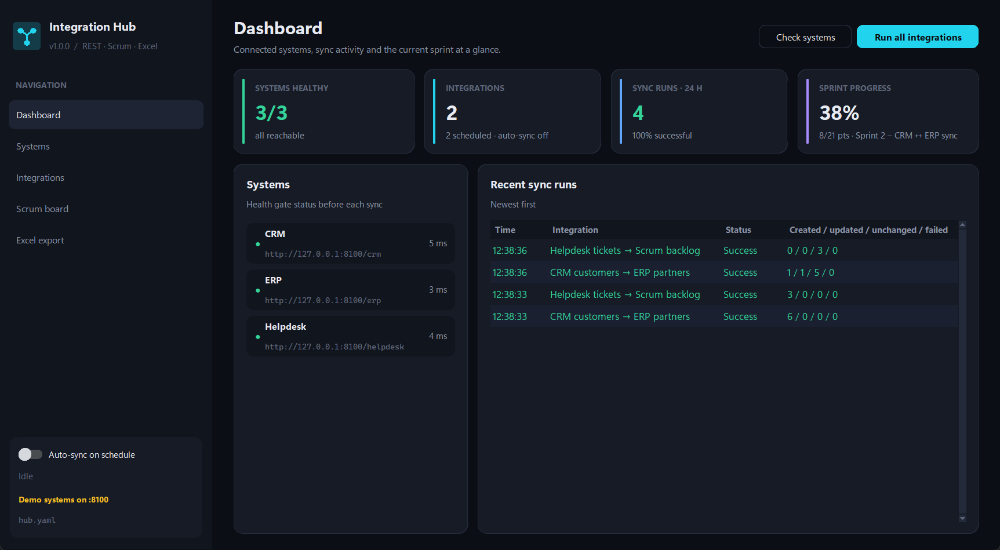
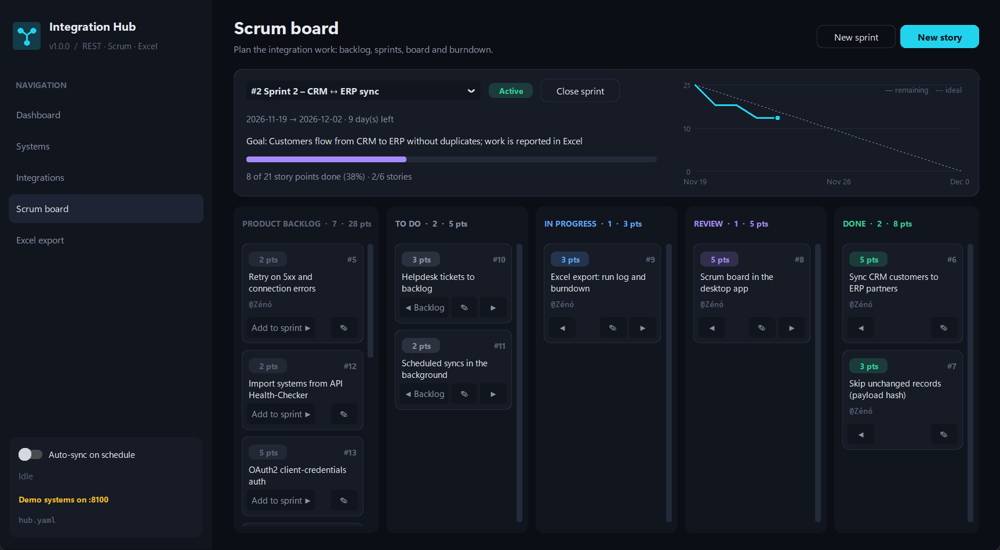
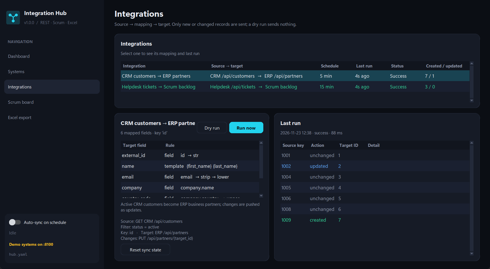
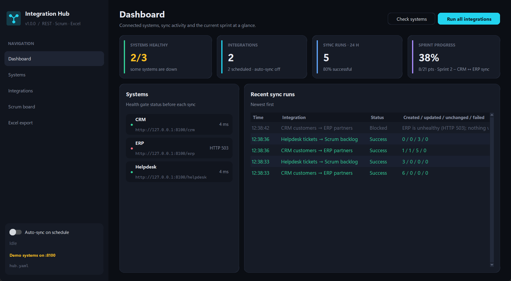
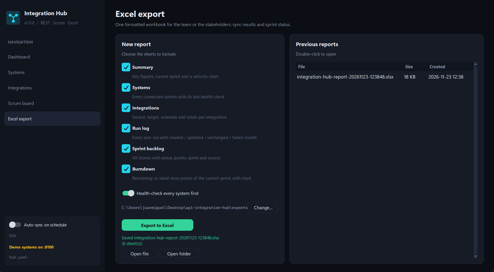
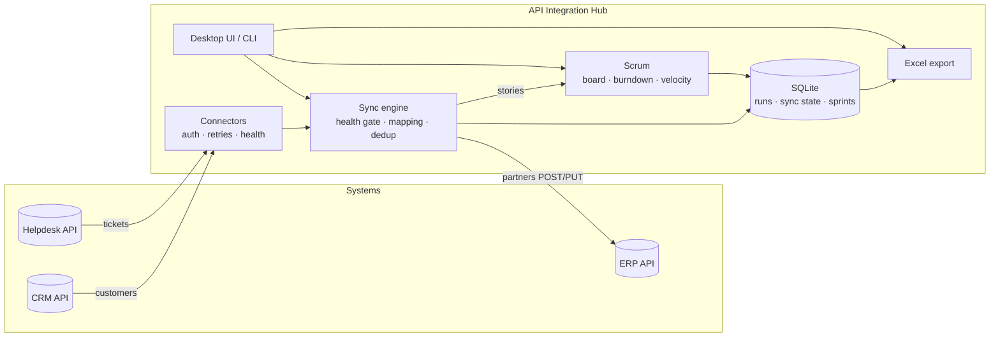

# API Integration Hub


-217346)


A small Windows desktop app that **connects business systems over REST APIs**, lets the team **plan the
integration work in Scrum**, and **reports everything to Excel**.

It grew out of my [API Health-Checker](https://github.com/juanmiguelaasg/api-health-checker): the
health-checker tells you *whether* a service is up — the hub uses the same idea as a **health gate** and then
actually *moves data* between systems. Systems can be imported straight from a Health-Checker `endpoints.yaml`.



---

## What it does

| | |
| :--- | :--- |
| 🔌 **Connect systems** | Each system has a base URL, an auth method (**API key**, **Bearer token**, **Basic auth**) and a health endpoint. Secrets come from environment variables or a `.env` file. |
| 🔁 **Sync with integrations** | *Source → filter → field mapping → target.* Mapping supports dotted paths, templates, transforms (`lower`, `upper`, `int`, `date`, …), value maps, defaults and constants. |
| 🧠 **No duplicates** | A hash of every mapped record is stored, so a rerun only sends **new** (POST) or **changed** (PUT) records — unchanged ones are skipped. |
| 🚦 **Health gate** | Before a sync, the source and target are health-checked. If one is down the run is **blocked** and nothing is sent. Connection errors and HTTP 5xx are retried. |
| 🧪 **Dry run** | Map the records and preview the exact payloads without sending anything. |
| 📋 **Scrum** | Product backlog, sprints (planned → active → closed), a four-column board, story points, **burndown** and **velocity**. Closing a sprint returns unfinished stories to the backlog. |
| 🎫 **Tickets → backlog** | An integration can target the Scrum backlog: open high-priority Helpdesk tickets become user stories automatically (once). |
| 📊 **Excel export** | One formatted workbook: summary + velocity chart, systems, integrations, full run log, sprint backlog and a burndown chart — real Excel tables with filters and status colours. |
| ⏱️ **Scheduling** | Integrations can run every *n* minutes while the app is open (auto-sync switch), or from the CLI / a scheduled task. |

## Screenshots

| Scrum board | Integrations |
| :---: | :---: |
|  |  |
| **Health gate blocks a sync while the ERP is down** | **Excel export** |
|  |  |

## Architecture



| Module | Responsibility |
| :--- | :--- |
| `integrationhub/config.py` | Loads `hub.yaml`, expands `${ENV:-default}`, reads `.env`, imports Health-Checker endpoints |
| `integrationhub/connectors.py` | HTTP client per system: auth, retries on 5xx / connection errors, health check |
| `integrationhub/mapping.py` | Field mapping rules and source filters |
| `integrationhub/engine.py` | Health gate → fetch → filter → map → create / update / skip → run log |
| `integrationhub/store.py` | SQLite storage (safe to use from the UI and background threads) |
| `integrationhub/scrum.py` | Sprints, stories, board moves, burndown, velocity |
| `integrationhub/export.py` | Excel workbook with tables, conditional colours and charts |
| `integrationhub/ui/` | CustomTkinter desktop app (Dashboard, Systems, Integrations, Scrum board, Excel export) |
| `mock_systems.py` | Demo CRM, ERP and Helpdesk APIs on one port, with outage / change controls |

## Quick start (Windows)

```bat
setup.bat          :: creates .venv and installs requirements
start_gui.bat      :: opens the app in demo mode (starts the demo APIs + demo sprints)
```

Or by hand:

```bash
py -m venv .venv
.venv\Scripts\python -m pip install -r requirements.txt
.venv\Scripts\python -m integrationhub gui --demo
```

In demo mode the app starts the demo systems on `http://127.0.0.1:8100` and creates two demo sprints.
Click **Run all integrations**, then try the demo controls:

```bash
curl -X POST "http://127.0.0.1:8100/__demo/touch"                     # change a customer -> 'updated'
curl -X POST "http://127.0.0.1:8100/__demo/new-customer"              # new customer      -> 'created'
curl -X POST "http://127.0.0.1:8100/__demo/outage?system=erp&down=1"  # ERP down          -> run 'blocked'
```

## Command line

Everything works without the GUI too (handy for scheduled tasks and CI):

```bash
python -m integrationhub check                                  # health-check every system
python -m integrationhub run --all                              # run every integration
python -m integrationhub run "CRM customers → ERP partners" --dry-run
python -m integrationhub export --check -o report.xlsx          # Excel report
python -m integrationhub sprint                                 # board of the current sprint
python -m integrationhub sprint new --name "Sprint 3" --start 2026-12-07 --end 2026-12-18 --goal "OAuth2"
python -m integrationhub story add --title "Webhook trigger" --points 5
python -m integrationhub story move --id 12 --status done
python -m integrationhub import-healthchecker ..\api-health-checker\endpoints.yaml
python -m integrationhub demo-api                               # just the demo systems
```

Exit codes: `0` success, `1` partial sync or an unhealthy system, `2` failed / blocked run or config error.

## Configuration – `hub.yaml`

```yaml
systems:
  - name: ERP
    base_url: ${ERP_URL:-http://127.0.0.1:8100/erp}
    health: /health
    auth: {type: bearer, token: "${ERP_TOKEN:-demo-erp-token}"}   # or api_key / basic / none

integrations:
  - name: CRM customers → ERP partners
    source: {system: CRM, path: /api/customers, filter: {status: active}}
    target:
      system: ERP
      path: /api/partners            # POST for new records
      update_method: PUT
      update_path: /api/partners/{target_id}   # PUT for changed records
    key: id                          # identifies a source record between runs
    mapping:
      external_id: {from: id, transform: str}
      name: "{first_name} {last_name}"           # template
      email: {from: email, transform: [strip, lower]}
      company: company.name                      # dotted path
      country_code: {from: company.country, transform: upper}
      source_system: {const: CRM}
    schedule_minutes: 5
```

| Mapping rule | Example | Result |
| :--- | :--- | :--- |
| Path | `company.name` | value at that path |
| Template | `"{first_name} {last_name}"` | `Anna Kovács` |
| Transforms | `{from: email, transform: [strip, lower]}` | `lower`, `upper`, `strip`, `title`, `str`, `int`, `float`, `bool`, `date` |
| Value map | `{from: priority, map: {critical: 5, high: 3}, default: 2}` | `3` |
| Constant | `{const: CRM}` | `CRM` |

Target `scrum: backlog` instead of a system turns records into Scrum stories (fields `title`, `points`,
`description`, `assignee`). Secrets: copy `.env.example` to `.env` (git-ignored) or set environment variables.

## Tests

```bash
.venv\Scripts\python -m pytest -q
```

27 tests run against the real demo APIs on a random port: mapping rules, first sync / rerun / change detection,
the health gate, dry runs, all three auth types, retries, ticket → story deduplication, sprint lifecycle,
burndown, velocity, the Excel workbook and the Health-Checker import. GitHub Actions runs them on Ubuntu and
Windows, then performs a demo sync and uploads the Excel report as a build artifact.

## Related projects

- [API Health-Checker](https://github.com/juanmiguelaasg/api-health-checker) – the project this hub builds on
- [System Process Monitor](https://github.com/juanmiguelaasg/SystemProcessMonitor)
- [AI Log Analyzer](https://github.com/juanmiguelaasg/ai-log-analyzer)
